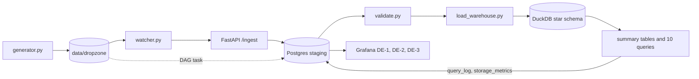

# Pharma Cold Chain DWH + BI Pipeline

Intelligent Data Architectures, Fall 2026 | Phase 1: Sales & Demand Intelligence (SDI) data mart | **Milestone 1** (pipeline up to the query layer)

An automated data engineering pipeline for a pharmaceutical cold supply chain. Apache Airflow orchestrates synthetic data generation, file-watcher ingestion into Postgres staging, validation, a DuckDB star schema, an optimised query layer, and Grafana dashboards that monitor each stage.

**Team:** Muhammad Ismail(30917), Aftab Ahmed(30526) 

## Milestone 1 status

| Spec layer | Status | Where to look |
|---|---|---|
| Data oversampling (generator as an Airflow task) | Done | `src/generator.py`, task `generate_data` |
| Ingestion (file-watcher + API) and batch dashboard | Done | `src/watcher.py`, `src/ingest_api.py`, `src/ingest.py`, DE-1 |
| Storage & staging (Postgres) and storage dashboard | Done | `src/create_staging.py`, DE-2 |
| Transformation & dimensional modeling (DuckDB) | Done | `sql/`, `src/load_warehouse.py` |
| Query layer & optimisation and query dashboard | Done | `src/queries.py`, `src/run_queries.py`, `sql/40_build_summaries.sql`, DE-3 |
| BI dashboard and two live refreshes | Milestone 2 (25 Nov) | n/a |
| Streaming ingestion dashboard | Phase 3 (IoT data) | n/a |

## Architecture



## Airflow DAG `phase1_pipeline`

| Task | What it does |
|---|---|
| `generate_data` | Writes the next month of data to the drop zone, or copies the original CSVs when triggered with `{"initial_load": true}` |
| `ingest_to_staging` | Loads every CSV in the drop zone into Postgres, logging duration, rows and status in `ingestion_log` |
| `validate` | Applies SQL rules; failing rows go to `rejected_records` with the rule name and the raw row |
| `load_dimensions` | Builds and updates the DuckDB dimensions, including the SCD Type 2 pass for `dim_medicine` |
| `load_facts` | Appends new validated sales and hospital demand facts (incremental, history is never replaced) |
| `build_summaries` | Rebuilds the six pre-aggregated summary tables |
| `log_metrics` | Records storage metrics and times the analytical queries (feeds DE-2 and DE-3) |

## Quick start

```bash
# 1. Put the three instructor-provided files in data/raw/:
#    01_master_data.csv, 05_pharmacy_sales_data.csv, 06_hospital_demand_data.csv

# 2. Start Airflow, Postgres staging and Grafana
docker compose up -d --build

# 3. Python dependencies for scripts run on your machine
pip install -r requirements.txt pandas numpy psycopg2-binary

# 4. Create the staging and log tables (Postgres is exposed on localhost:5433)
python src/create_staging.py
```

5. Open Airflow at http://localhost:8080 (admin / admin), unpause `phase1_pipeline` and use **Trigger DAG w/ config** with `{"initial_load": true}`. **Always run the initial load first**: sales and demand rows are validated against the master data.
6. Trigger the DAG again without config for refresh 1 (Jan 2026), and once more for refresh 2 (Feb 2026).
7. Open Grafana at http://localhost:3000 (admin / admin). The **Phase 1** folder is provisioned automatically from `grafana/`.

Optional live file watcher (any CSV dropped in `data/dropzone` is sent to the API):

```bash
cd src
uvicorn ingest_api:app --port 8000   # terminal 1
python watcher.py                    # terminal 2
```

Useful scripts:

```bash
python src/check_warehouse.py                  # reconciliation checks (staging vs warehouse, SCD2 integrity)
python src/quality_report.py                   # validation results per batch and per rule
python src/make_test_file.py                   # drops a file with 8 deliberately bad sales rows
python src/run_queries.py baseline --replace   # time the queries on the base star schema
python src/run_queries.py optimized --replace  # time them with summary tables and the index
python src/run_queries.py compare
python src/reset_environment.py                # wipe staging, warehouse, logs and state for a clean run
```

## Data model (DuckDB star schema)

- `fact_pharmacy_sales`: transaction fact, one row per sale. Transaction, order, delivery, lot, production batch and prescription IDs are kept as degenerate dimensions.
- `fact_hospital_demand`: periodic snapshot fact, one row per hospital, medicine and month.
- `dim_date`: role-playing (sales date, delivery date, batch expiry date).
- `dim_medicine`: SCD Type 2 on manufacturing cost, wholesale price, retail price and product status; other attributes are Type 1.
- `dim_pharmacy`, `dim_hospital` (with a bed-size band), `dim_geography`: Type 1.
- `dim_sales_profile` and `dim_demand_flags`: junk dimensions for low-cardinality flags.
- Every dimension has an unknown member with key -1. `dim_date`, `dim_medicine`, `dim_hospital` and `dim_geography` are shared by both facts, which is the basis for the Phase 4 fact constellation.

## Validation

Rules live in `src/validate.py` as SQL predicates (M01-M06 master, H01-H08 hospital demand, S01-S15 sales). They cover non-blank keys, unique IDs, valid dd-mm-yy dates, price above zero, non-negative quantities, net and margin formulas, expiry after the sale date, delivery before the sale date, and known medicines and hospitals. Failing rows never reach the warehouse; they stay in `rejected_records` with the rule, the reason and the raw row as JSON. Dropped record rate = rejected rows / staged rows.

## Query layer

Ten analytical queries (`src/queries.py`): monthly sales and margin by channel, channel by pharmacy type margin, top 10 fast and bottom 10 slow movers, hospital forecast vs actual consumption, unfulfilled demand, delivery OTIF, e-commerce returns, pharmacy league table, and a batch trace.

Optimisation: six pre-aggregated summary tables rebuilt on every run (`sql/40_build_summaries.sql`), plus an index on `fact_pharmacy_sales(production_batch_id)` for the selective batch trace (Q10). Each query runs in a baseline form (star schema) and an optimised form (summary table), five repetitions each, and the results are checked to be identical. Every execution is timed into `query_log`.

## Dashboards (Milestone 1)

| Dashboard | Metrics | Main chart |
|---|---|---|
| DE-1 Batch ingestion | Load duration, rows per batch, batch success rate, records dropped by validation | Horizontal bar: load duration per file |
| DE-2 Storage | Row count per table, storage footprint (MB), date coverage, storage by source domain | Donut: storage by domain |
| DE-3 Query performance | Average query time, queries executed, error rate, baseline vs optimised time | Bar: average time per query |

Dashboards are code: `src/make_dashboards.py` defines them, `src/export_dashboards.py` writes `grafana/dashboards/*.json`, and `grafana/provisioning/` loads the data source and dashboards when Grafana starts. They read only from the Postgres log tables, so no manual Grafana setup is needed.

## Assumptions

- Source dates are `dd-mm-yy`. The hospital file has a mislabelled header (`MED003` instead of `MedicineID`), renamed on load.
- Staging keeps every column as text plus audit columns (`batch_id`, `source_file`, `load_timestamp`); typing and cleaning happen in DuckDB.
- Invalid rows are rejected, not repaired.
- A medicine gets a new SCD2 version only when cost, price or status changes; other attribute changes overwrite the existing row.
- Facts use the medicine version valid on the sale date (the demand month for hospital demand); earlier dates use the first version.
- Only sales made by a hospital pharmacy carry a hospital key; all others use the unknown member (-1).
- OTIF flag, warehouse and delivery date are assumed identical on every line of a delivery (checked in `build_summaries.py`).
- Generator: each refresh adds 5% of the existing sales rows, one month of hospital demand, and 5 price revisions. Revised retail price = revised wholesale x 1.32 and sales tax = 6% of net, both inferred from the original data.
- DuckDB table sizes are estimated from storage blocks; Postgres sizes use `pg_total_relation_size`.

## Repository layout

```
dags/phase1_pipeline.py       Airflow DAG
src/                          generator, ingestion (watcher, API), validation, warehouse load,
                              queries, metrics, dashboards, reset and check scripts
sql/                          validation functions, star schema DDL, SCD2, dimension and fact loads, summaries
grafana/                      provisioning (data source, dashboard provider) and dashboard JSON
docs/                         data profile and Phase 1 data generation report
deliverables/                 generated Phase 1 data files
docker-compose.yml            Airflow, Postgres (airflow + staging) and Grafana
```

## Roadmap

- **Milestone 2 (28 Nov):** BI dashboards (forecast vs actual and unfulfilled demand, channel revenue and margin, fast vs slow movers) and two live refreshes.
- **Phase 2 (5 Dec):** inventory, expiry and replenishment mart.
- **Phase 3 (12 Dec):** traceability and IoT cold chain mart.
- **Demo (14 Dec):**
- **Bonus:** unified fact constellation and master DAG.